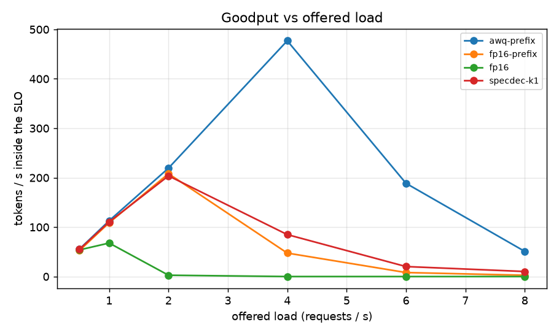
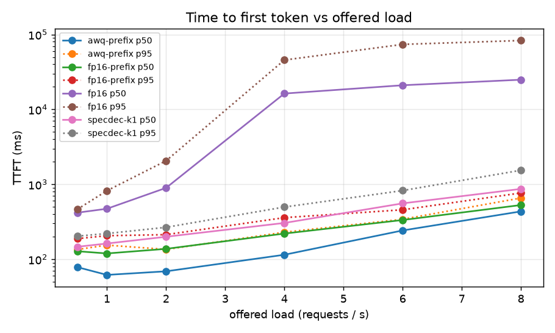
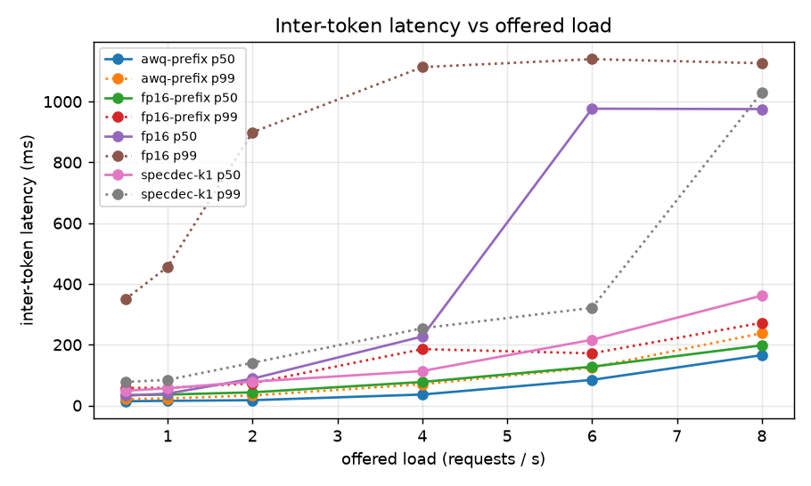
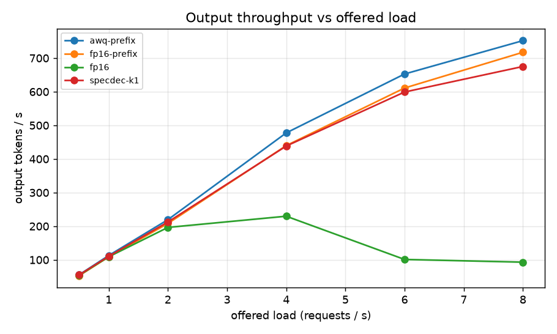
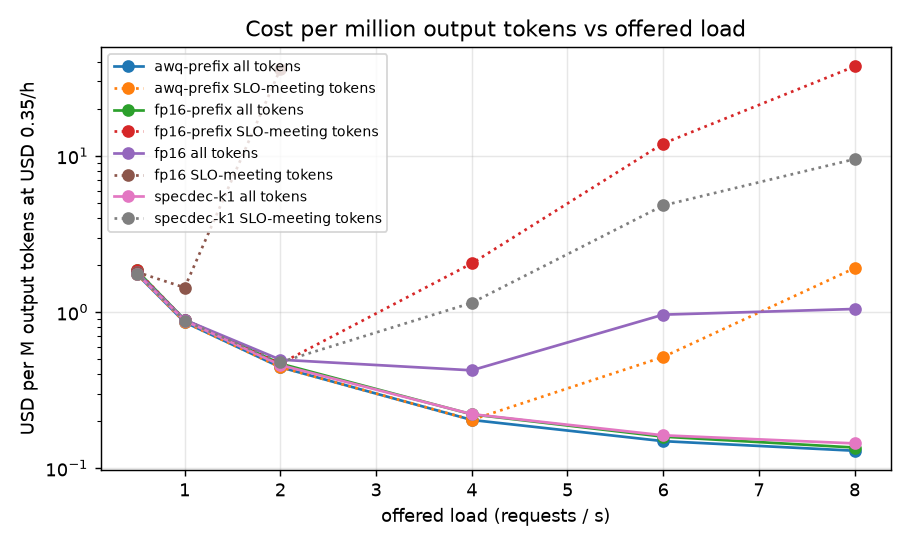

# serving-benchmarks

Public, reproducible latency, throughput and cost benchmarks for three LLM serving configurations, with full methodology and raw data.

Project 15 of 15 in [inference-infra-portfolio](https://github.com/NomanJafar/inference-infra-portfolio).

## What this builds

Load curves for Qwen2.5-3B-Instruct on one T4 under four servers, all measured with the same open-loop [tokenbench](https://github.com/NomanJafar/tokenbench) sweep:

| slug | configuration | why it is here |
|---|---|---|
| `fp16` | FP16, prefix caching off | the reference: every request pays its full prefill |
| `fp16-prefix` | FP16, prefix caching on | attribution: how much of the next row is the cache |
| `awq-prefix` | AWQ 4-bit + prefix caching | the "cheap serving" configuration |
| `specdec-k1` | FP16 + 0.5B draft model, k=1 | the "fast decode at low load" configuration |

For each: TTFT and ITL percentiles against offered load, output tokens per second, goodput under a stated SLO (TTFT ≤ 1 s, TPOT ≤ 60 ms), the knee (the load with the most goodput), and $ per million output tokens at an assumed $0.35/h, for all tokens and for the tokens that met the SLO.

[METHODOLOGY.md](METHODOLOGY.md) is the contract: configurations with exact `vllm serve` lines, the workload and why it is open-loop, the metric definitions, the SLO and price and why those values, threats to validity, and how to rerun. The analysis (`serving-benchmarks report`) is pure Python over tokenbench's JSON and is covered by 12 tests on synthetic sweeps, so the tables can be regenerated from the committed raw data by anyone.

## Why it matters

Public, reproducible benchmarks are the strongest hiring signal in infra, and most published ones fail on one of three counts: closed-loop load that hides saturation, no SLO so throughput counts tokens nobody waited for, or no raw data. This one is open-loop, reports goodput against a stated SLO, and commits every JSON it draws from.

## Status

Done. One full run on a Kaggle T4 (18 Oct 2026), all four configurations, written up below; raw JSON and the generated report in [results/kaggle_run1/](results/kaggle_run1/).

## Results (Tesla T4, vLLM 0.31.0, Qwen2.5-3B-Instruct, 18 Oct 2026)

One sweep per configuration: 0.5 → 8 req/s offered, 60 s per level, open loop, `sample` prompts behind the shared 560-word system prompt (825–850 prompt tokens per request, ~700 of them identical), natural stopping capped at 192 tokens (mean 137), SLO = TTFT ≤ 1 s and TPOT ≤ 60 ms, GPU priced at $0.35/h. "Achieved req/s" is below "offered" because the level's wall time includes draining the last requests. Tables are copied from [results/kaggle_run1/report/summary.md](results/kaggle_run1/report/summary.md) and [curves.md](results/kaggle_run1/report/curves.md).

### Summary

| config | weights | KV cache | **knee** (req/s) | out tok/s at knee | goodput tok/s | SLO pass at knee | **$/M good tokens at knee** | at 2 req/s: TTFT p50 | TPOT p50 | SLO pass |
|---|---|---|---|---|---|---|---|---|---|---|
| `fp16` (prefix caching off) | 5.79 GiB | 175,008 tok | **1** | 109 | 68 | 59 % | **1.40** | 896 ms | 165 ms | 1 % |
| `fp16-prefix` | 5.79 GiB | 187,744 tok | **2** | 208 | 208 | 100 % | **0.467** | 137 ms | 44 ms | 100 % |
| `awq-prefix` | 1.95 GiB | 287,072 tok | **4** | 478 | 477 | 99.6 % | **0.204** | 69 ms | 18 ms | 100 % |
| `specdec-k1` | 6.73 GiB | 110,528 tok | **2** | 212 | 204 | 95 % | **0.477** | 199 ms | 45 ms | 95 % |







### What the numbers say

1. **Prefix caching was the largest single lever, and its absence was catastrophic, not merely slow.** Without it every request re-prefilled ~700 shared tokens: 418 ms TTFT at 0.5 req/s (about 1,700 prompt tokens/s for a 3B model on this card), 896 ms at 2 req/s with the decode stall from [chunkedprefill-lab](https://github.com/NomanJafar/chunkedprefill-lab) showing as a 899 ms ITL p99, and at 4 req/s an overloaded server: TTFT p50 16 s. At 6 and 8 req/s **throughput fell** to ~100 tok/s with 179 and 305 timeouts, because the server kept generating tokens for requests the client had already abandoned. Goodput was zero from 4 req/s on. With caching on, the same server's knee moved from 1 to 2 req/s and its $/M good tokens from 1.40 to 0.47.
2. **With the prefill paid for, decode speed set the knee, and decode speed is weight bytes.** `fp16-prefix` met the SLO at 2 req/s (TPOT 44 ms) and failed it at 4 (81 ms, 10 % pass): the 5.8 GiB weight read per step is the limit. `awq-prefix` reads 1.95 GiB per step: TPOT 14–18 ms at low load (2.4x faster, in line with [quantlab](https://github.com/NomanJafar/quantlab)'s 3.2x at batch 1 fading with batch size), knee at 4 req/s with 477 tok/s of goodput (2.3x), and 53 % more KV cache. Its $/M good tokens at the knee, 0.204, is the cheapest number in the table. The quality cost is not in this table and is not zero: quantlab measured this AWQ checkpoint at +8.4 % perplexity and **−15 points on GSM8K** against FP16, where GPTQ-Int8 lost nothing. The right reading is "4-bit buys 2.3x goodput; pick the checkpoint whose accuracy loss you have measured", not "use AWQ".
3. **Speculative decoding at k=1 was a wash, and first it was a measurement bug.** The run recorded a 4 % SLO pass rate for `specdec-k1` at 2 req/s; the server was fine. tokenbench's TPOT divided by the number of stream chunks, and a speculative server emits ~1.7 tokens per chunk, so every per-token figure was inflated 1.7x. Recomputed per token from the raw records (METHODOLOGY section 4 addendum; tokenbench fixed the same day), the draft model made decode 1.18x faster at 0.5 req/s (29.6 vs 34.8 ms), equal at 2 req/s (44.9 vs 44.4), slightly better at 4 (72 vs 81 ms, 19 % vs 10 % pass), for +30–60 ms of TTFT (the draft's own prefill) and 41 % less KV cache. Same knee, same cost as `fp16-prefix`. That matches [specdec](https://github.com/NomanJafar/specdec)'s conclusion that k=1 pays only at very low concurrency on this GPU; here the shared-prefix workload gave it nothing extra.
4. **"Cost per token" without an SLO is a number that rewards overload.** Every configuration's all-token cost kept falling to $0.13–0.14 per M at 8 req/s, where between 0.6 % and 7.5 % of requests met the SLO. `fp16-prefix` at 8 req/s costs $0.136 per M tokens and **$37 per M good tokens**. The knee column is the only cost figure in this report that means anything, and it moves by 7x across the four servers (1.40 → 0.20) on the same GPU and the same model family.
5. **Against a hosted tier** at $0.60 per M output tokens, the AWQ server at its knee is 3x cheaper, FP16 with caching 1.3x cheaper, and FP16 without caching 2.3x *more* expensive, all at 100 % utilisation. [tokenmeter](https://github.com/NomanJafar/tokenmeter) measured what idle time does to these figures (at 30 % utilisation the price triples); the knee is a ceiling on efficiency, not a forecast.
6. **Cold starts were 110–196 s** (weights download included for the first use of each checkpoint), the same order as every other project here; nothing in the configuration changes it except the smaller AWQ download.

### Threats to validity, as they turned out

One run per configuration, one seed (section 6 of the methodology stands). The AWQ, FP16-with-caching and speculative curves are separated by factors of 1.5–2.3x at the knee, well outside run-to-run noise on this harness (tokenbench reproduced servellm's numbers within 2–5 %); the speculative-vs-FP16 gap at 0.5–1 req/s (10–18 %) is close to that noise and should be read as "about equal". The TPOT correction is derived from the raw records, not re-measured; the ITL columns (inter-chunk) still overstate the speculative server's per-token gaps and are left as recorded.

## Layout

| path | what |
|---|---|
| `METHODOLOGY.md` | sections 1–8: question, configurations, workload, metrics, hardware, threats to validity, rerunning, raw data |
| `src/serving_benchmarks/configs.py` | the four `BenchConfig`s, `serve_command()`, the deterministic 560-word `system_prompt()` |
| `src/serving_benchmarks/analysis.py` | `curve_rows()`, `knee()`, `usd_per_m_tokens()`, `summary_rows()`, Markdown tables |
| `src/serving_benchmarks/report.py` | `build_report()`: summary.md, curves.md, summary.json, five plots |
| `src/serving_benchmarks/cli.py` | `serving-benchmarks report\|configs\|sweep-args`; the tokenbench command every configuration is measured with |
| `tests/` | synthetic sweeps that saturate; cost arithmetic, knee, pairing of sweeps with startup info, report files, CLI |
| `notebooks/kaggle_serving_benchmarks.ipynb` | the T4 run |
| `results/` | one directory per run with the raw JSON and the report |

## Running

```bash
python -m venv .venv && source .venv/bin/activate
pip install -e ".[dev]"
pytest
serving-benchmarks configs        # the four vllm serve lines
serving-benchmarks sweep-args     # the tokenbench command
# after a run:
serving-benchmarks report --results results/kaggle_run1 --gpu-usd-per-hour 0.35 --common-rps 2
```

## Hardware notes

Developed against free-tier GPUs (Kaggle and Colab T4, 16 GB). Where a T4 limits what can be measured (no FP8, Turing-era kernels, Triton attention only), the README says so rather than papering over it.

## License

MIT
